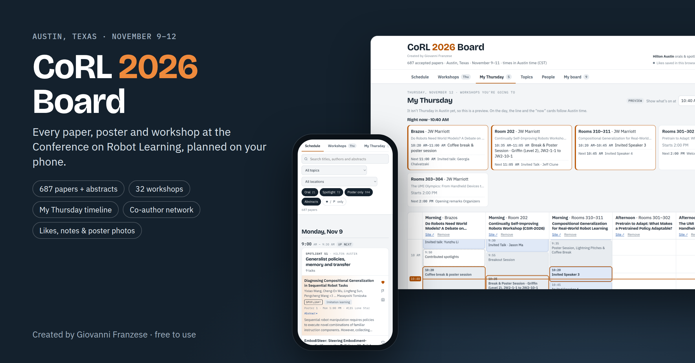
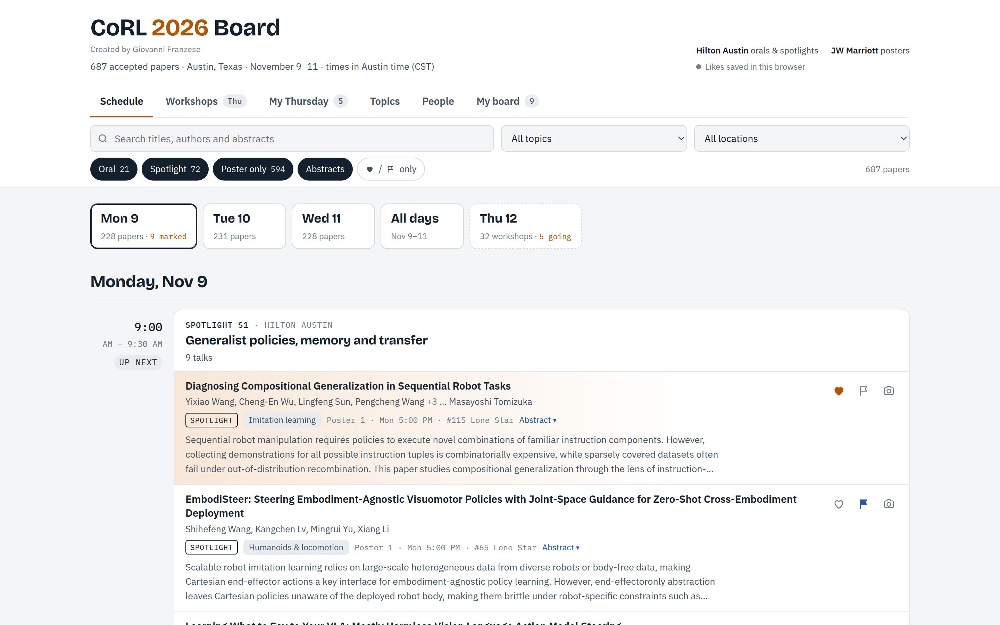
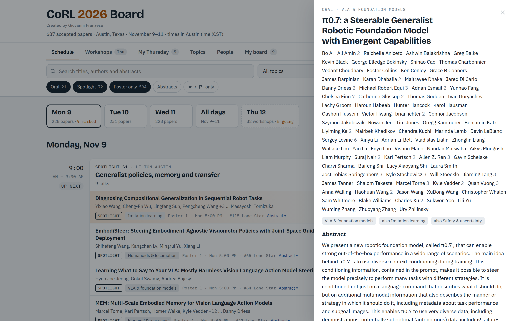
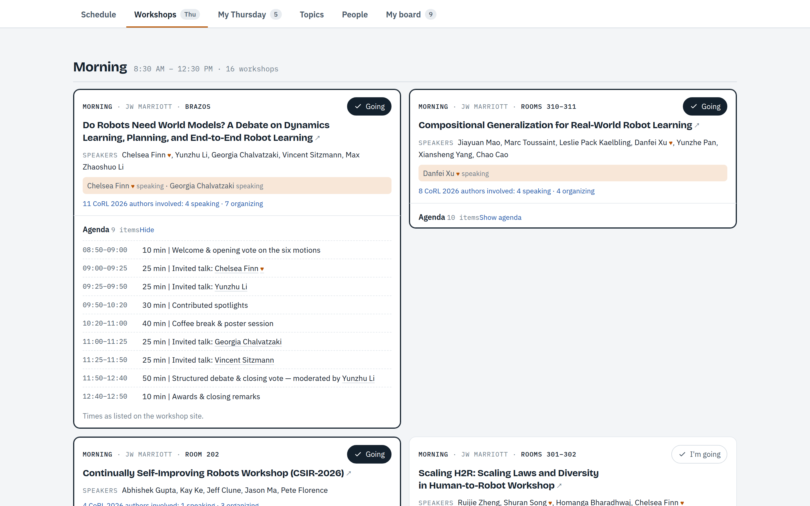
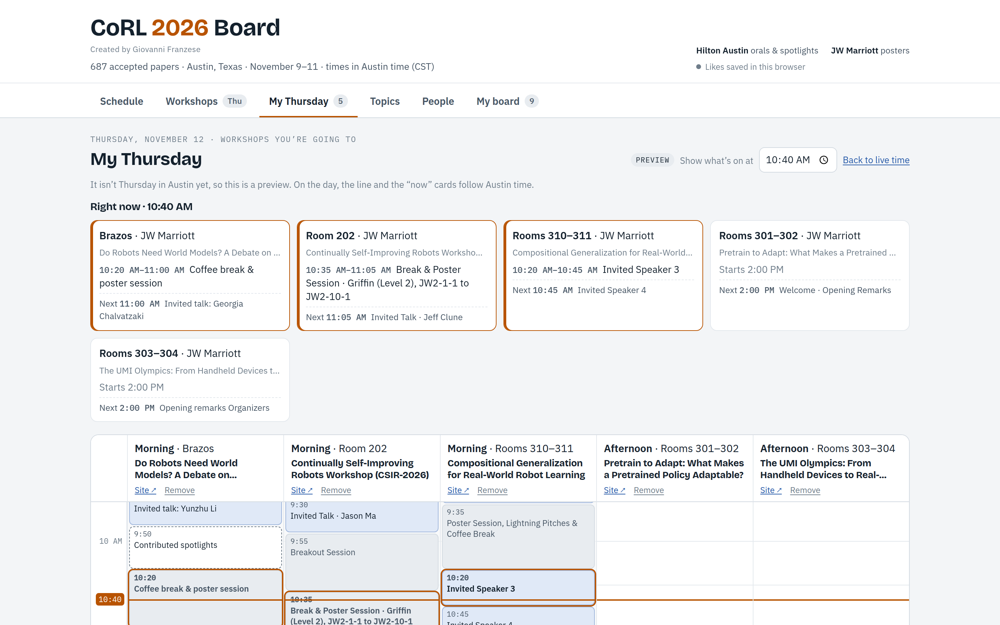
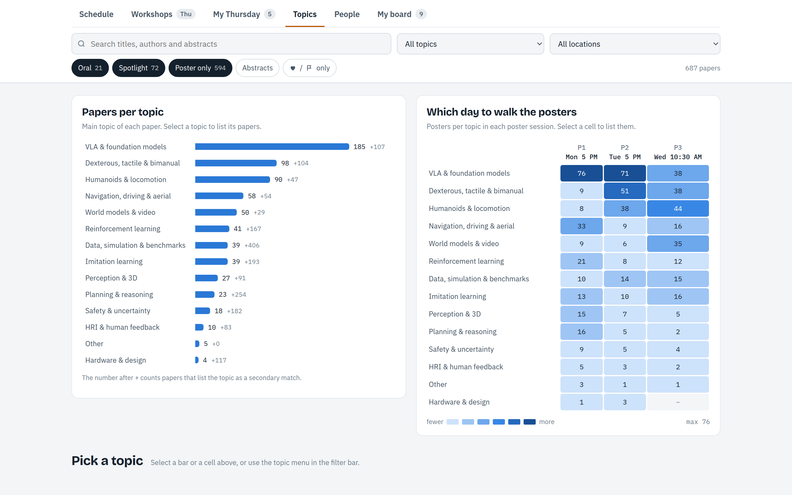
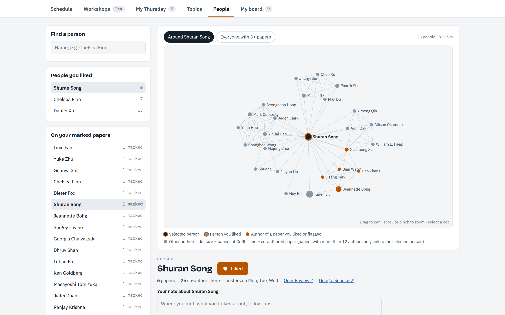
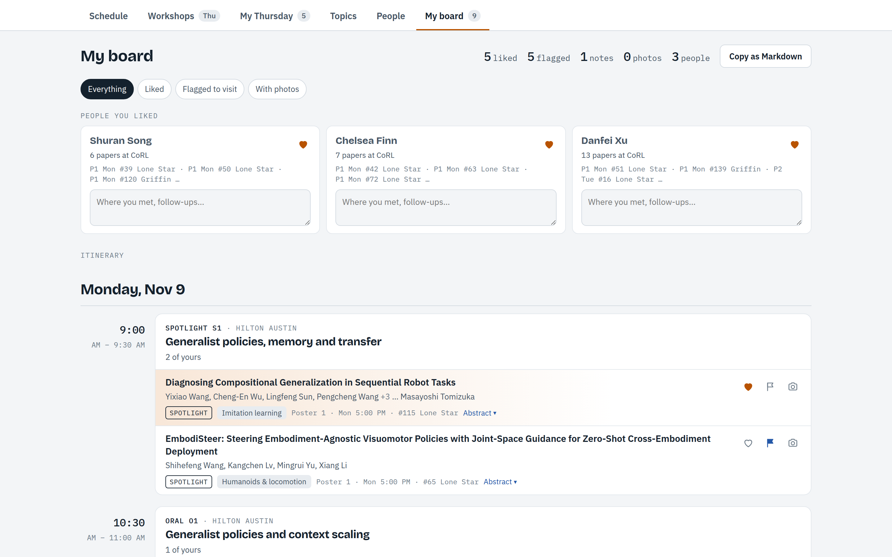
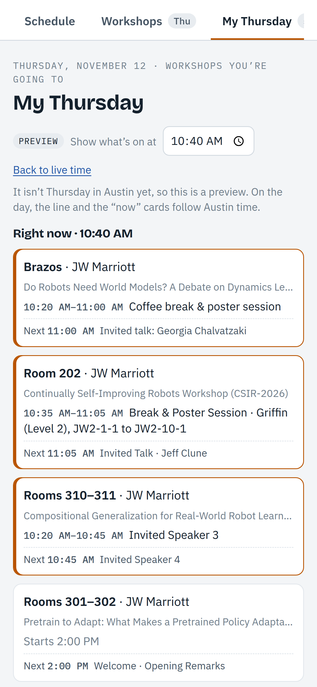

# CoRL 2026 Board



A pocket guide to the [Conference on Robot Learning 2026](https://2026.corl.org/) (Austin, Texas, November 9–12): all 687 accepted papers and all 32 workshops in one page you can use on your phone.

Created by Giovanni Franzese.

## What it does

- **Schedule**: every paper by day and session (orals and spotlights at the Hilton, posters at the JW Marriott) with poster number, room and floor. Filter by topic, presentation type and location, and see what is on now.
- **Workshops** (Thursday, Nov 12): the 32 workshops with room, invited speakers and agenda, read from each workshop's website. Mark the ones you are going to.
- **My Thursday**: your chosen workshops side by side on one timeline, with a "now" line and what is happening in each room right now.
- **Topics**: papers per topic and which poster day suits your area.
- **People**: co-author network, each person's papers and workshop talks, and where to find them. Like people and keep notes on who you met.
- **My board**: your liked and flagged papers as an itinerary in the order you will see them, your notes, your poster photos and the people you liked. Copy it all as Markdown.

## Screenshots

The likes, flags and workshops marked in these screenshots are examples.

| Schedule, with abstract previews | Paper details |
|---|---|
|  |  |
| **Workshops** | **My Thursday** |
|  |  |
| **Topics** | **People** |
|  |  |
| **My board** | **On the phone** |
|  |  |

To regenerate them after an update: `python board/build_board.py && python docs/screenshots/make_screenshots.py`.

## Use it

There are two ways. Start with the first one; the second is only needed if you want your picks synced across devices.

**1. Try it now (no account, no install):** open **https://franzesegiovanni.github.io/corl2026_board/** on your phone or laptop. Everything works, and your likes, notes and photos are saved privately in that browser. They are not synced to your other devices.

**2. Your own synced copy (optional, needs Claude):** with [Claude Code](https://claude.com/claude-code) signed in to your claude.ai account, publish your own private copy. Your likes, notes, Thursday plan and photos are then saved to your account and follow you between laptop and phone.

```bash
git clone https://github.com/franzesegiovanni/corl2026_board.git
cd corl2026_board
claude "/publish-board"
```

Claude publishes `board/corl2026_board.html` as your own private artifact and gives you the link. Your likes, notes, Thursday plan and poster photos are then stored privately with your account. Claude reads the page before publishing it, so the first publish takes a moment. Artifacts need a claude.ai plan where they are available.

## Rebuild the data

Python 3, standard library only.

```bash
python corl2026_download.py --dry-run      # paper metadata -> CoRL2026/index.csv (add no flag to also download the PDFs)
python board/extract_abstracts.py          # abstracts + keywords from the downloaded PDFs -> board/abstracts.json (needs pdftotext)
python board/build_workshops.py --refresh  # workshop rooms from corl.org + agendas and speakers from each workshop site
python board/build_board.py --refresh      # official paper schedule + everything above -> board/corl2026_board.html and index.html
```

`corl2026_download.py` reads accepted papers from OpenReview. If OpenReview asks for a login, set `OPENREVIEW_USERNAME` and `OPENREVIEW_PASSWORD` as environment variables. Never commit them.

## Where the data comes from, and its limits

- Papers: OpenReview (CoRL 2026 accepted papers).
- Paper schedule, poster numbers and rooms: the official [accepted papers page](https://2026.corl.org/program/accepted-papers).
- Workshop rooms and sessions: the official [workshops page](https://www.corl.org/program/workshops). Rooms are marked tentative by CoRL.
- Workshop agendas and speakers: each workshop's own website, read automatically. Sites differ a lot, so a few entries may be incomplete or misread. Times are shown as each site lists them. Check the workshop site for last-minute changes.
- Topics are assigned by keyword matching on titles and abstracts, so treat them as a rough guide.
- People are matched by exact name, so two people with the same name can be mixed up.

This is an unofficial community tool, not affiliated with CoRL.
